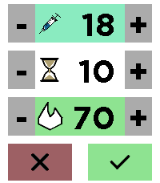

# xDrip Treatment App



This app allows you to enter treatment items into xdrip via a pebble watch. Currently you need a custom build to do this, until the changes get merged into xDrip. You can compile it yourself from either https://github.com/jstevensog/xDrip-NS-Dev or https://github.com/consp/xDrip-NS-Dev (note: use the PebbleFramework branch)

Usage:

* No item selected:
  * select:
    * once: select item
    * twice: enable/disable item to send
  * up/down: move to previous/next item
  * back: send data (if any selected) or cancel, same as red and green buttons
* Item selected:
  * select:
    * once: deselect item
    * twice: enable/disable item to send
  * uo/down: add/subtract, hold down for continous. 
  * back: send data (if any selected) or cancel, same as red and green buttons

TODO: change the scheme to something more usable.

## Building & running

```sh
git submodule init
git submodule update
pebble build                          # build for all targetPlatforms
pebble install --emulator emery       # install on the emery emulator
pebble install --phone <ip>           # install to a paired phone
```

## Target platforms

Only emery and gabbro are supported, the other platforms do not support touch.

# Legal

This app is provided as-is. No warranty or liability can be claimed from using this app or using code to build your own. This app is not Open Source, but source available. App is provided under CC-NC 4.0. Commercial use is prohibited.
